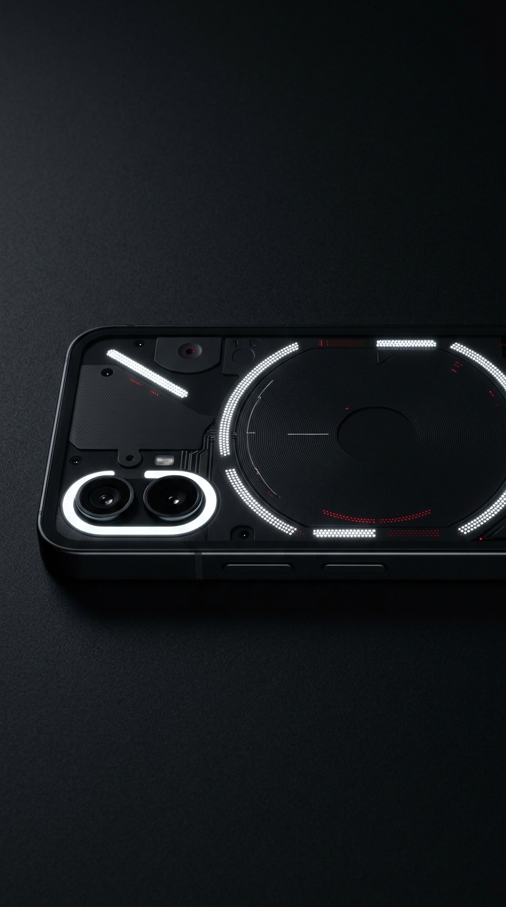

# Dot Dial

  
  <h3>A Nothing OS–inspired Android dialer with a dot-matrix interface</h3>
  
<b>Current project line: v2.2 · Android 7.0+ (API 24+)</b>

  

    <a href="https://github.com/Ajking420/Dot-Dial/releases">Releases</a> ·
    <a href="https://github.com/Ajking420/Dot-Dial/actions">Builds</a> ·
    <a href="https://github.com/Ajking420/Dot-Dial/issues">Issues</a>
  

> The canonical v2.2 build input is **`DotDial_v2.2_scroll_performance_fixed_source.zip`**. The repository's root-level `app/` and Gradle files have now been synchronized from this archive, and the GitHub Actions build workflow extracts the same archive before compiling.

## Overview

Dot Dial is an Android phone dialer project built around a customizable dot-matrix / Glyph-inspired interface. It combines everyday calling and contact tools with optional personalization, call utilities, analytics and AI-assisted features.

## Features

- **T9 predictive dialing** — search contacts by typing a name using the dial pad.
- **Contacts and call history** — contact browsing, management and recent-call screens.
- **Customizable interface** — dot-matrix styling, themes, typography, backgrounds and visual effects.
- **Caller backgrounds** — image/video backdrop options for the calling experience.
- **Custom vibration patterns** — Glyph-inspired vibration feedback.
- **In-call controls** — custom in-call screen, call actions, audio-route handling and notifications.
- **Call recording tools** — recording-related controls and a private vault interface. Recording support depends on Android version, device/OEM restrictions, permissions and local law.
- **Spam tools and call analytics** — number screening utilities, call statistics and user-managed number rules.
- **AI features** — Gemini-backed assistant/command features and optional voice-related call tools. These require the relevant service configuration and permissions.
- **Backup and export** — local export and Google Drive backup-related functionality.
- **Home-screen contact widget** — quick access to selected contacts.

Some calling, recording, Bluetooth, voice and AI capabilities vary by device, Android release, region, permissions and configured services. The app may need to be selected as the default phone app for full dialer / in-call integration.

## Project artwork

These are artwork assets bundled with the project, not screenshots of live app screens.

  

For real screenshots of the dial pad, contacts, settings and in-call screens, add device screenshots to a `docs/screenshots/` folder and link them here. We have not labelled artwork as screenshots.

## Download

Use the **Releases** page for installable APKs:

- [Open Dot Dial releases](https://github.com/Ajking420/Dot-Dial/releases)
- The [Dot Dial v2.2 Stable APK](https://github.com/Ajking420/Dot-Dial/releases/tag/v2.2-stable) is published from the successful GitHub Actions build using the persistent release-signing key.

Install only APKs you trust. Android may ask you to allow installation from the browser or file manager used to open the APK.

## Source code and build

- **Canonical v2.2 source archive:** [DotDial_v2.2_scroll_performance_fixed_source.zip](./DotDial_v2.2_scroll_performance_fixed_source.zip)
- **Build workflow:** [Build DotDial v2.2 release APK](./.github/workflows/build-dotdial-apk.yml)
- **Scroll fix notes:** [SCROLL_PERFORMANCE_FIX.md](./SCROLL_PERFORMANCE_FIX.md) (inside the source archive)

The build workflow extracts the v2.2 archive, checks the version metadata and builds the release APK with Gradle. Run it from the **Actions** tab in GitHub.

### Build requirements

- Android SDK / Android Gradle Plugin toolchain used by the workflow
- JDK 21
- Gradle 9.3.1
- Android platform SDK 36.1 and Build Tools 36.0.0
- A configured Gemini API key for AI features where required
- A persistent signing keystore for repeatable distribution builds

**Signing note:** Android updates must be signed with the same signing certificate as the installed app. Do not generate a fresh signing key for every release. The v2.2 Stable APK is signed with the persistent Dot Dial release key. Its certificate SHA-1 has been registered in Firebase. Preserve this exact signing identity for future updates.

## Version notes

See [CHANGELOG.md](./CHANGELOG.md) for the v2.2 Stable release notes.

## Privacy and permissions

Dot Dial requests permissions for phone calls, contacts, call history, microphone, notifications and Bluetooth-related functionality. Grant only the permissions needed for the features you use. Review the app's behavior and applicable recording laws before enabling call recording.

## Contributing and support

Bug reports and feature requests are welcome through [GitHub Issues](https://github.com/Ajking420/Dot-Dial/issues). Include your device model, Android version, app version and relevant logs; remove phone numbers and other personal information before sharing logs.

---

  Dot Dial · Android dialer project · v2.2

